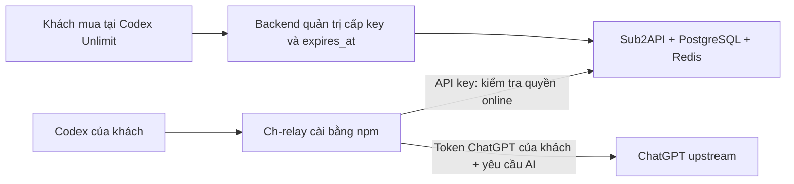

# Hệ thống Sub2API + Ch-relay



Trang `https://codexunlimit.tudonghoa.me` hiện là trang bán hàng/hướng dẫn. Hệ thống được chuẩn bị tại workspace này; không có thay đổi hay triển khai lên website đó. Không cần đưa tài khoản ChatGPT của khách vào Sub2API.

## Dựng server

Cần Node.js 24.18+, Git, Docker và Docker Compose v2. Chạy từ root workspace:

```text
node scripts/prepare-sub2api.mjs
node scripts/init-sub2api.mjs
docker compose -f deploy/sub2api/compose.yaml up -d --build
docker compose -f deploy/sub2api/compose.yaml ps
```

`prepare-sub2api` lấy đúng commit `25608d216bb7be04e4a646830cb065cd09b7d7e9`, áp dụng các thay đổi có kiểm tra ngữ cảnh và overlay trong `integrations/sub2api`. Chạy lại được. Bản upstream khác bị từ chối để tránh áp dụng nhầm bản vá. Không dùng nút cập nhật binary upstream trong dashboard vì sẽ làm mất tích hợp.

`init-sub2api` tạo `deploy/sub2api/.env` với mật khẩu ngẫu nhiên, không in secret. File này chứa tài khoản admin ban đầu (`ADMIN_EMAIL`, `ADMIN_PASSWORD`); chỉ mở trên máy quản trị. Nếu file tồn tại, script dừng, không tự đổi mật khẩu. Không commit `.env`.

File secret được đặt quyền 0600 trên Unix, hoặc ACL chỉ cho tài khoản Windows hiện tại, SYSTEM và Administrators. Trên Windows, chạy các lệnh vận hành bằng chính tài khoản đã tạo file.

Mở `http://127.0.0.1:18080`. Cổng chỉ bind loopback; PostgreSQL và Redis không mở cổng ra host. Volume riêng giữ dữ liệu khi recreate container. `docker compose down` giữ dữ liệu; không dùng `down -v` nếu cần giữ key và khách hàng.

Để dùng từ máy khách, dựng trên VPS có domain Sub2API riêng và HTTPS, tham khảo `deploy/sub2api/Caddyfile.example`. Chỉ thay đổi DNS/reverse proxy và publish khi chủ hệ thống đã yêu cầu. Docker Desktop local phải chạy để môi trường local hoạt động.

## Quyền cấp key

Compose bật `CH_RELAY_LICENSE_ONLY=true`:

- Khách không được tạo key hay sửa ngày hết hạn qua `/api/v1/keys`. Có thể xem và xóa key của chính mình.
- Key hợp lệ phải do API quản trị Ch-relay cấp, có tên bắt đầu `ch-relay:` và có `expires_at` hữu hạn.
- Endpoint xác thực đọc key mới từ database, không sử dụng auth cache. Middleware gốc vẫn kiểm tra key, tài khoản, nhóm và IP ACL.
- Số dư/quota AI không quyết định quyền Ch-relay. Key không cần gắn tài khoản upstream hoặc gói thuê bao AI.
- Các key hết hạn/thu hồi không vượt qua được kiểm tra, kể cả Sub2API chạy simple mode. Hệ thống triển khai mặc định dùng standard mode.

Triển khai này dành riêng cho Ch-relay. Không bật chế độ này trên một Sub2API đang bán API AI thông thường vì nó khóa việc tự tạo/sửa key của mọi khách.

## API quản trị để nối trang bán hàng

Dùng xác thực admin hiện có của Sub2API. Admin credential phải nằm trên backend bán hàng, không gửi xuống trình duyệt hay package npm. Hoàn tất phần xác nhận quản trị mà bản upstream yêu cầu trong dashboard trước khi gọi API.

1. Tạo hoặc chọn user bằng trang Users/API quản trị Sub2API. Số dư có thể bằng 0.
2. Khi đơn hàng được xác nhận ở backend, gọi:

```http
POST /api/v1/admin/ch-relay/licenses
Content-Type: application/json
Authorization: Bearer <ADMIN_ACCESS_TOKEN>

{"user_id":123,"name":"order-123","expires_in_days":30}
```

Response dùng envelope `data` của Sub2API; đọc `data.key`, `data.id`, `data.expires_at`. Thời hạn bắt đầu lúc cấp key. Chưa có tính năng tự bắt đầu thời hạn từ lần kích hoạt đầu tiên.

Gia hạn hoặc thu hồi:

Có thể dùng CLI quản trị local; lệnh issue chỉ in đường dẫn file key, không in secret:

```text
node scripts/admin-license.mjs issue --user-id 123 --name order-123 --days 30
node scripts/admin-license.mjs list --user-id 123
node scripts/admin-license.mjs renew --id 456 --expires-at 2026-12-31T16:59:59Z
node scripts/admin-license.mjs revoke --id 456
```

Chọn user ID ở trang Users của Sub2API. Key nằm trong `.runtime/issued/` (không commit). Để quản trị server khác, đặt `SUB2API_SERVER` và `SUB2API_ADMIN_TOKEN`; CLI không tự gửi mật khẩu admin local tới server khác.

```http
PUT /api/v1/admin/ch-relay/licenses/456
Content-Type: application/json
Authorization: Bearer <ADMIN_ACCESS_TOKEN>

{"expires_at":"2026-12-31T16:59:59Z","status":"active"}
```

```json
{"status":"inactive"}
```

`status: inactive` thu hồi. `expires_at` bắt buộc là RFC3339 nếu gửi; không thể bỏ hạn thành vô hạn. UTC được khuyến nghị để tránh nhầm múi giờ.

Việc xác thực thanh toán, chống xử lý webhook trùng và ràng buộc order với key thuộc backend trang bán hàng. API cấp key hiện không tự xác thực thanh toán, và một POST tạo key mới mỗi lần; backend phải lưu order→key ID, bảo đảm idempotency trước khi gọi. Chưa có mã nguồn/quyền triển khai trang Codex Unlimit trong workspace nên chưa gắn webhook thanh toán live.

## Gói npm

```text
npm ci --prefix test/relay-product-build-tools --ignore-scripts
npm run build:npm -- --server https://sub2api.example.com
```

Kết quả `dist/codexunlimit-0.4.1.tgz`. `--server` ghim domain vào gói khách; client chuẩn không cho đổi sang máy chủ tùy ý. Khi thử local có thể bỏ tham số; `codexunlimit` sẽ hỏi địa chỉ và key trong terminal.

Khách tải file qua trang hướng dẫn rồi chạy:

```text
npm i -g ./codexunlimit-0.4.1.tgz
codexunlimit
```

Gói chỉ chứa CLI bundle, helper DPAPI và README, không có admin/server/secret/checkout. Gói có `private: true` để không vô tình publish. Tên `codexunlimit` hiện do tài khoản npm `datngo68` quản lý; bản tích hợp 0.4.1 chưa được publish. Khi chủ gói xác nhận phát hành, cần dùng tài khoản có quyền, ghim domain Sub2API HTTPS thực tế và đổi cờ private trong package phát hành. Sau đó khách có thể dùng đúng hai lệnh `npm i -g codexunlimit` và `codexunlimit`.

Đọc `docs/CH-RELAY-NPM.md` để đưa hướng dẫn lên trang khách hàng.

## Endpoint xác thực

```http
GET /v1/ch-relay/license
Authorization: Bearer <SUB2API_KEY>
```

```json
{"schema":"ch-relay-license-v1","active":true,"feature":"ch-relay","key_id":456,"server_time":"2026-11-06T00:00:00Z","expires_at":"2026-12-06T00:00:00Z"}
```

Không dùng `/v1/usage` để quyết định quyền: bản upstream cho phép key hết hạn đọc usage và một số dạng response không chứa hạn key. Client không cache quyền qua lần chạy/mất mạng, không dựa vào đồng hồ lịch của máy khách. Các stream đang chạy kiểm tra lại tối đa mỗi 30 giây, timeout 10 giây, và có timer riêng tại ngày hết hạn đã biết.

## Kiểm thử

```text
npm run test:sub2api
npm test
node test/check_sub2api_live.mjs
```

Test npm dùng thư mục riêng, HTTP fixture và key giả; không thay cấu hình Codex đang dùng. Test Go cho hợp đồng endpoint và chặn khách tự sửa key nằm trong overlay, được copy vào checkout khi prepare. Xem `docs/VERIFICATION-SUB2API.md` để biết những gì đã được chạy thực tế.

Để chạy test Go không cần cài Go vào host:

```text
docker build --target backend-builder --build-arg GOPROXY=https://proxy.golang.org,direct --build-arg GOSUMDB=sum.golang.org -t tn-ch-relay-builder:local .reference/sub2api
docker build -f integrations/sub2api/Test.Dockerfile -t tn-ch-relay-tests:local integrations/sub2api/overlay
```

Mã nền: [toolcodex](https://github.com/datngo68/toolcodex), [Sub2API](https://github.com/Wei-Shaw/sub2api). Commit toolcodex dùng làm nền: `0eaa5c192fe5b8e0731198cb77b3d0fa99076b1d`. Bản đóng gói local không thể bảo đảm chống sửa/crack bởi người nắm toàn quyền máy.
